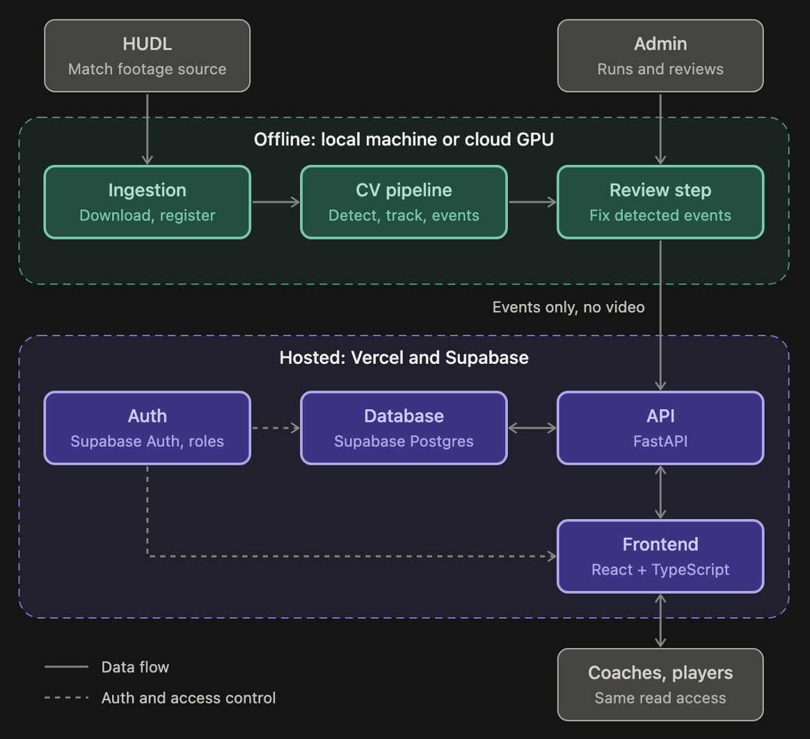
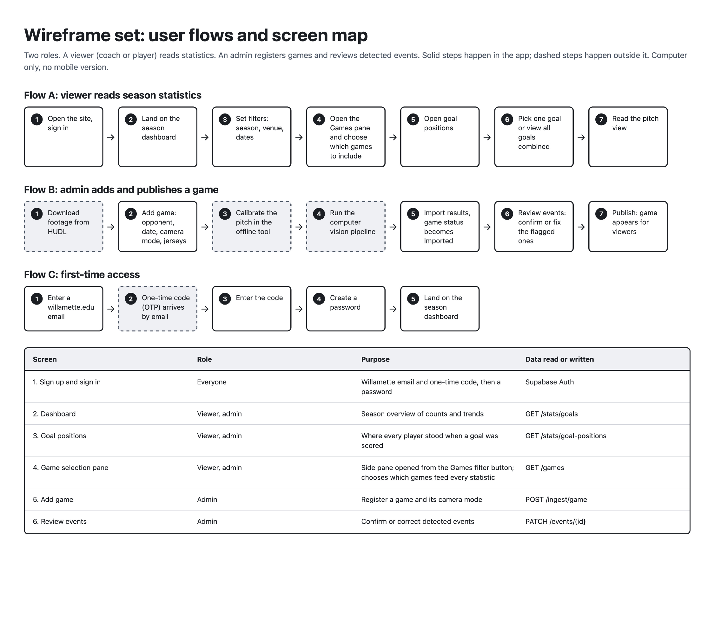
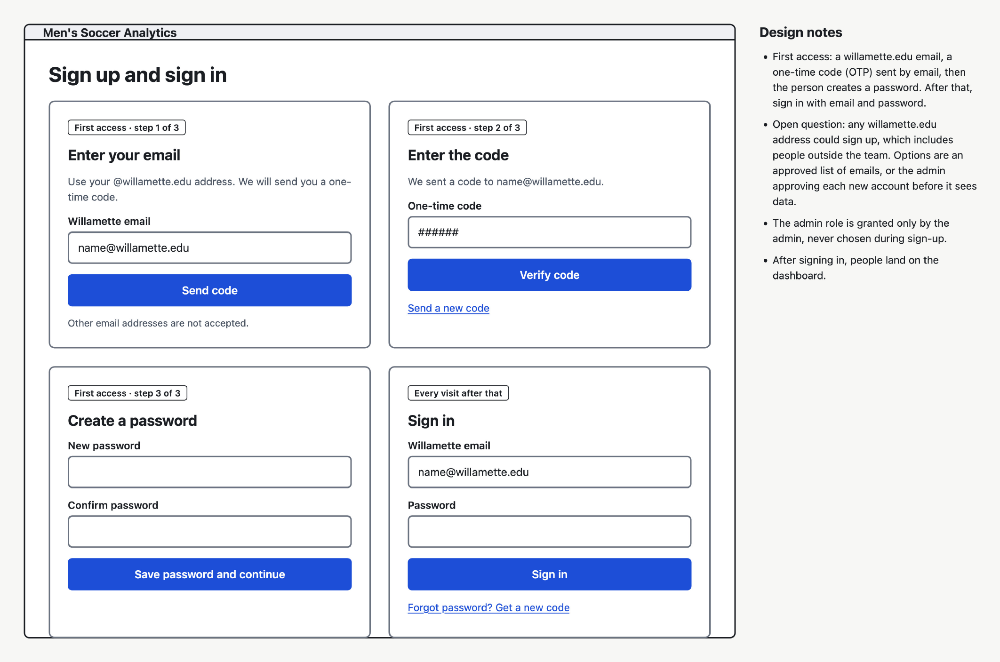
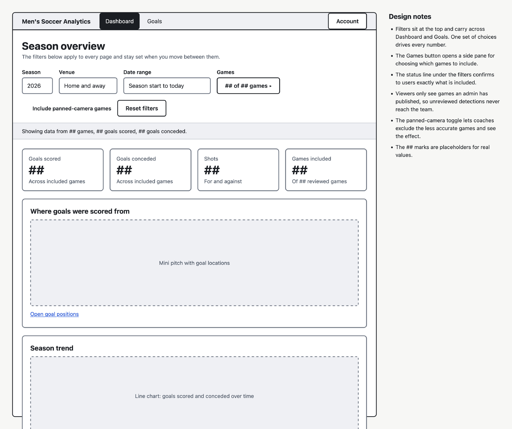
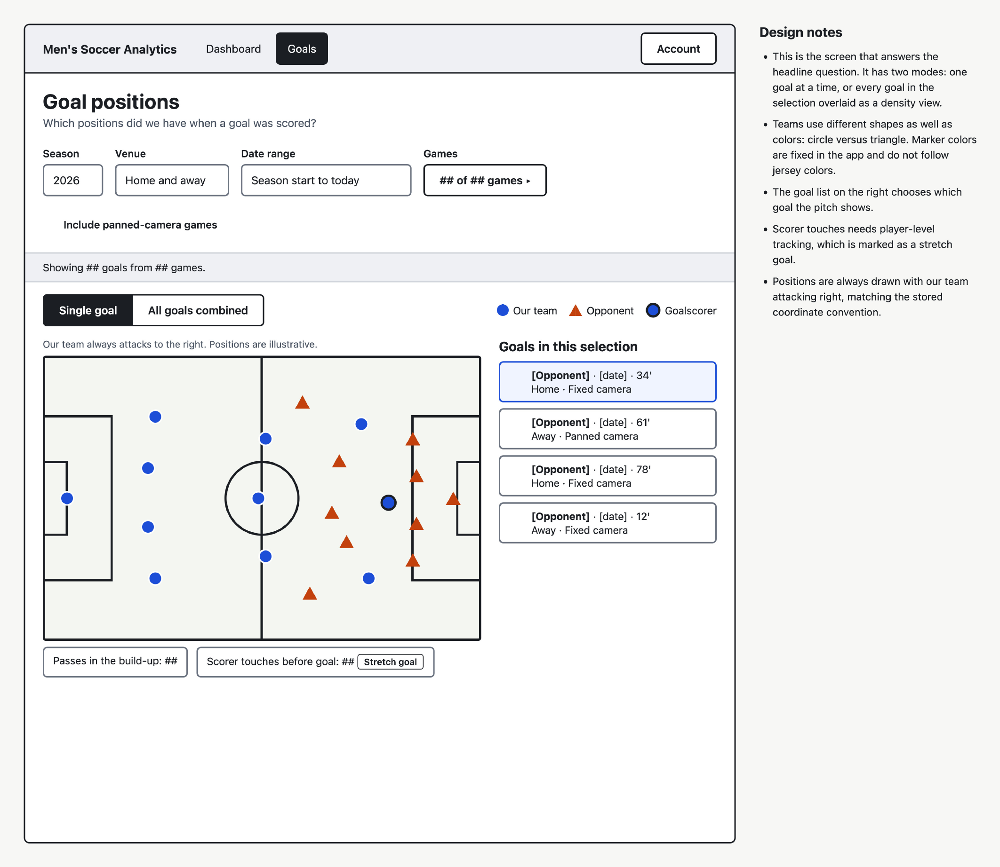
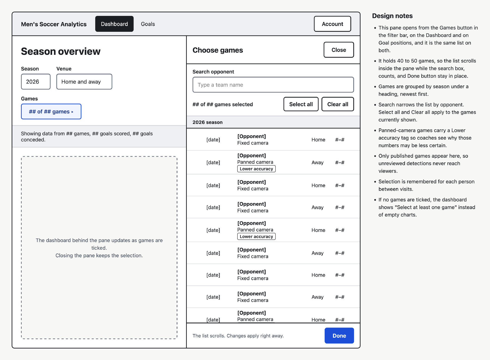
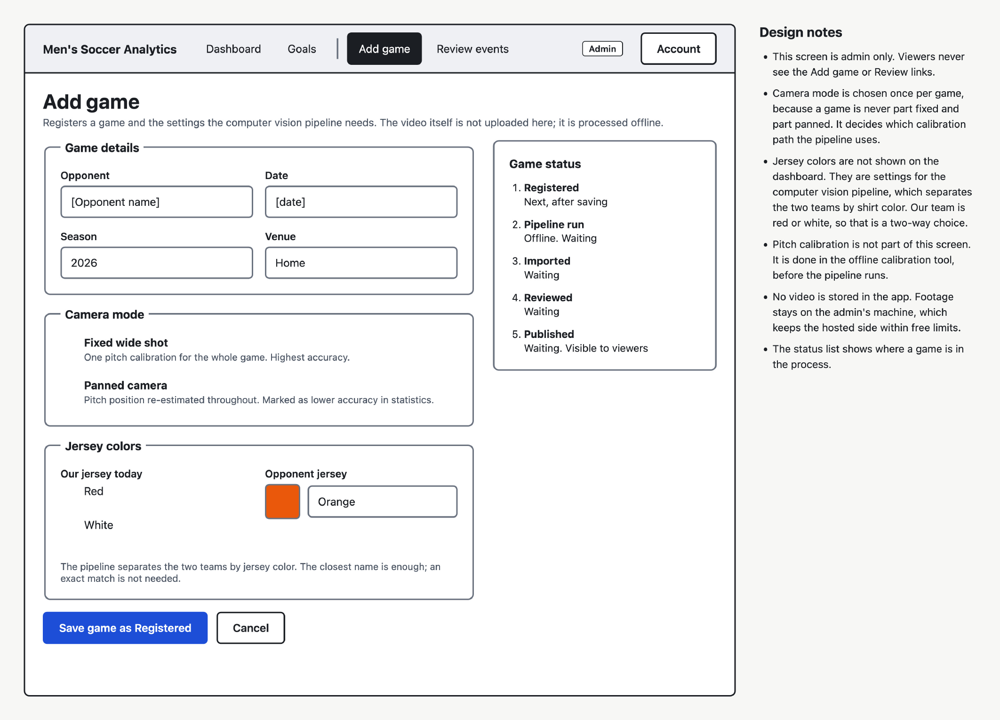
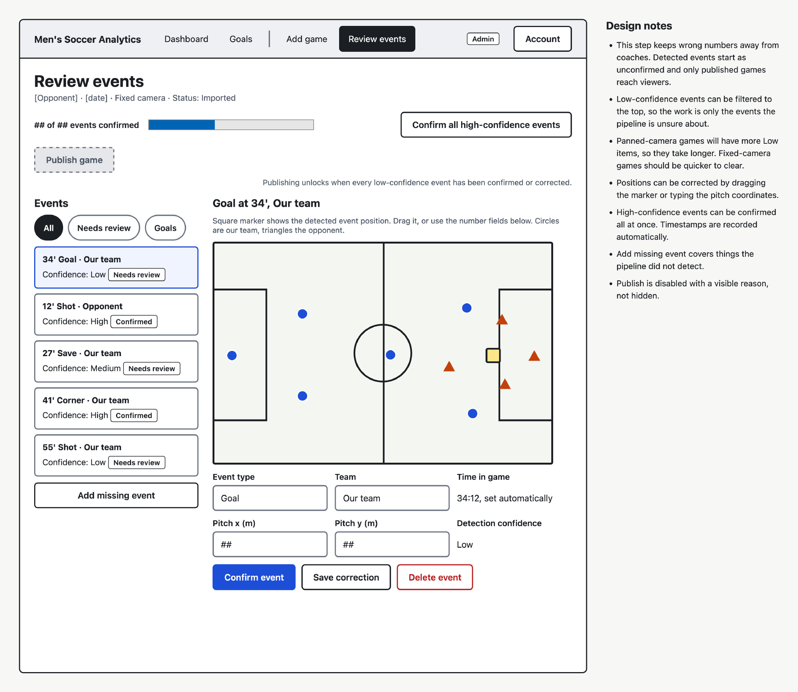

# Architecture

This page describes the high-level architecture of the Soccer Statistics project: a platform that uses computer vision to detect on-field events in Willamette Men's Soccer match footage and turns them into season-long statistics and visualizations.

:::note
The technology choices below reflect the current plan. Items marked *planned* may change as the project progresses.
:::

## Overview

The system is split into two halves so it can be hosted for free:

1. **An offline processing pipeline** that runs on a local machine (or a rented cloud GPU if needed). It takes match video, detects players and the ball, tracks them across frames, and extracts on-field events such as shots, passes, goals, and saves.
2. **An online platform** that stores only the resulting structured statistics. A backend API serves that data to a web dashboard, where coaches and players filter games and view aggregated visualizations.

Heavy computation never happens on the hosting provider. Only small, structured results are uploaded, which keeps hosting costs and size limits out of the way.

## Components

| Component | Responsibility | Technology (planned) |
| --- | --- | --- |
| Video ingestion | Import match footage downloaded from HUDL (semi-automatic, since automated scraping is prohibited by HUDL's terms) | Local scripts |
| Detection | Find players and the ball in each frame | Ultralytics YOLO |
| Tracking | Keep player and ball IDs consistent across frames | ByteTrack |
| Pitch mapping | Convert pixel positions to real pitch coordinates | Homography estimation |
| Team separation | Assign players to teams by jersey color | Color clustering |
| Event detection | Derive shots, passes, goals, saves, and touches from tracked data | Custom logic |
| Storage | Persist games and events, support aggregation across games | Supabase (Postgres) |
| API | Serve filtered and aggregated statistics | FastAPI |
| Dashboard | Filters, visualizations, season-wide views | React + TypeScript, SVG charts |

## Data Flow

In words:

1. A match recording is downloaded from HUDL.
2. YOLO detects the ball and players in every frame, and ByteTrack links those detections into consistent tracks.
3. Homography maps pixel positions onto pitch coordinates, and jersey color assigns each player to a team.
4. Event detection turns the tracks into discrete events such as a shot, a goal, or a pass, each with a timestamp, team, and pitch position.
5. The structured events are uploaded to Postgres.
6. The FastAPI backend answers queries such as "all goals in away games" or "pass counts before goals across the season."
7. The React dashboard renders the results and lets users include or exclude any set of games.

## Design Decisions

- **Offline processing.** Free hosting tiers cannot run video inference, so all heavy work happens locally and only structured statistics are uploaded.
- **Season-level aggregation.** Every event is stored with its game, so any statistic can be recomputed over any chosen set of games. This is the main capability HUDL's existing reports lack.
- **Validation.** Pipeline output is checked against manual tracking of 2-3 short clips, and the dashboard's statistics are checked against open datasets such as StatsBomb.

### Wireframes

[Download the full wireframe (PDF)](/files/wireframe.pdf)

*Figure 1: Overall user flows*

*Figure 2: Sign up user flow*

*Figure 3: Main dashboard (landing page), grey boxes will contain diagrams*

*Figure 4: Single goal view*

*Figure 5: Filter pane allowing user to select specific games to include/exclude in the visualization*

*Figure 6: Form for adding games. Admin view only*

*Figure 7: Review step before publishing data. Admin view only *

## Open Questions at this time

- How reliably can the pipeline detect goals, shots, and passes from the available camera angle?
- How long does processing one full match take, and is a cloud GPU needed?
- Can the final database and hosting stay within free-tier limits?