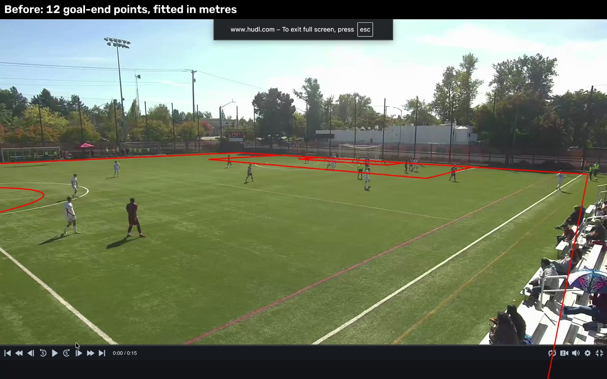
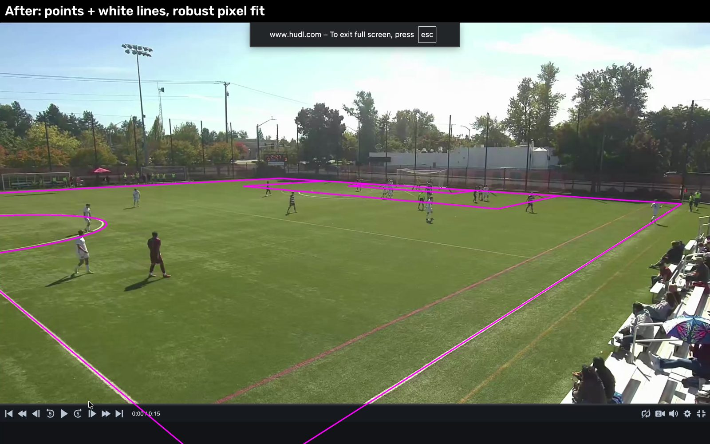

# Pitch Calibration

Every statistic the platform shows, such as where players stood when a goal was scored, how far a pass travelled, or which zones produce chances, depends on knowing where things are **on the pitch in metres**, not where they are on the screen in pixels. Calibration is what allows this translation between real life and pixels on a screen. If it's off by a few metres, every position, distance and speed is off too.

This page describes the problem, the first approach and why it was not good enough, the changes made, and the measured improvement.

## The problem

The pipeline sees a 2D video. The pitch is a flat rectangle. Because the pitch is flat, one 3×3 matrix (a **homography**) maps every pixel on the grass to a pitch coordinate in metres. To find that matrix, the pipeline needs pixels whose pitch position is known: corners, penalty spots, goallines, arches and boxes, are all regulated under the laws of the game, and so, they're dimensions are fixed. These were the stables of the first version of the calibration.

Several things about the Willamette footage make this harder than in textbook examples:

| Challenge | Why it matters |
| --- | --- |
| **Low, side-on camera.** The camera sits about 5 m up, beside the touchline close to the middle of the field (estimated at roughly x = 49 m, y = 72 m). | The far half of the pitch is squeezed into a thin band of pixels, so a 2-pixel click mistake there is a lot larger error in metres on the pitch. |
| **The camera pans and zooms.** On the test clips the camera moved up to 22 % in zoom and 700 px sideways within 12 seconds. | A calibration made on one frame is wrong on every frame where the camera has moved. |
| **Other sports' lines.** The Willamette turf, as well as many others in the Northwest Conference, is a multipurpose-field. This means it has other sports' lines painted onto it in different colors: mainly red, orange and yellow, but sometimes also white! | A fit that drifts onto the wrong line looks plausible but is metres off, and then carries erroneous numbers through the entire pipeline.|


## First version (before)

The first calibrator asked the user to click about 9–12 landmarks (corner flag, goalposts, box corners, penalty spot) on one frame. It then fitted the matrix with OpenCV's `cv2.findHomography`, minimising error **in pitch metres**.

This approach had four weaknesses:

1. **All the clicks were at the goal end.** The landmarks the tool asked for are all near the goal. The fit was well anchored there and drifted freely everywhere else, including the foreground and midfield, where most of the play happens.
2. **The error was measured in the wrong space.** Minimising error in metres means a 2 px slip on a far-away landmark (which is worth several metres) dominates the whole fit, while precise clicks in the foreground barely count.
3. **One misclick could ruin it.** Every click counted equally, so one bad click pulled the whole fit.
4. **There was no honest quality number.** The only check was how well the clicks fit the matrix that was built from those same clicks. That number looks good even when the calibration is badly wrong away from the clicked points.

The figure below shows the result on one of the test clips with a wide camera angle. The pitch lines predicted by the old calibration (red) are close to the paint near the goal but wrong everywhere else. The near touchline runs into the stands, and the centre circle is in the wrong place.


*Figure 1: First version. 12 clicked goal-end points, fitted in metres. Clearly not a desirable fit.*

## What was changed

### 1. A robust fit in pixel space

The matrix is now fitted by minimising error **in image pixels**, where click accuracy is roughly the same everywhere (about 2 px). It uses a Huber loss: errors up to 3 px count normally, and larger errors count only linearly, so a single misclick cannot ruin the entire fit.

### 2. Clicks spread over the whole frame, including along lines

The calibrator now asks for midfield landmarks too (halfway line, centre spot, centre circle) and supports **line clicks**. A line click is any spot along a painted line, with no need to find an exact corner. Lines are long and rarely hidden by players, so they are easier to click accurately than corners. Each line click tells the fit "this pixel lies somewhere on the line y = 65 m", for example.

The window also has a magnifier that shows the full-resolution pixels under the mouse, and a "not visible" key, so the user can skip a corner rather than guess it.

### 3. Snapping to white paint

After the clicks are saved, the pipeline improves the fit automatically:

- It projects each soccer line through the current fit and looks for white paint either side of it.
- "Whiteness" is the **minimum** of the red, green and blue channels. White paint scores high on all three. Red, orange, yellow and green all have almost no blue, so the other sports' lines are invisible to it.
- Paint spots found along a line must agree on one straight line, and a line needs at least 6 spots to be used.
- The search narrows over four passes (4 m, 2 m, 1 m, then 0.5 m either side of the line), and the fit is redone after each pass.
- A clicked point that the paint-fitted pitch places more than 10 px away is treated as a misclick and dropped.

The result is a calibration built from hundreds of automatically found paint spots instead of a dozen hand clicks.

### 4. Honest quality numbers

The calibrator now reports three numbers while the user clicks:

| Number | What it measures |
| --- | --- |
| **Fit (px)** | How far the clicks sit from the fitted pitch. In-sample, so it flatters the fit. |
| **Held-out worst (m)** | Refit without each click in turn and measure how far off that click lands. This tests the calibration on data it did not see. |
| **Expected error (m)** | Refit 40 times with simulated 2 px click noise and measure how much each point on the visible pitch moves. A colour map (green under 0.5 m, yellow under 1.5 m, red above) shows the user where to add clicks. This visually tells the user where pitch calibration is the weakest.|

### 5. Following the moving camera

Because the camera pans and zooms on a fixed mount, any view maps onto any other view by a homography. The pipeline matches background features (trees, buildings, fences) between each frame and the calibration frame, ignoring players. That gives a per-frame chain:

**frame t → calibration frame → pitch metres**

So the calibration only has to be right on the one frame it was made on. The tracker keeps a small library of past views, so a 45-minute half needs no more memory than a short clip. It also finds the video area inside the screen recording and ignores the browser bars and player controls.

### 6. Re-using a calibration on another clip

Clips filmed from the same camera mount can share a calibration. `pipeline/refine.py` matches the background of the new clip to the calibrated one, moves the clicks across, and snaps the result to the new clip's white paint. No clicking is needed.

The figure below shows the much improved 2nd version of the pitch calibration which is the one currently used. It is calibrated on the same clip as the first version. 


*Figure 2: Current version on the same frame. Points plus line clicks, robust pixel fit, snapped to white paint.*

## Results

### Simulated test with a known answer

On real footage nobody knows the true pitch position of every pixel, so the first test uses a **virtual camera** built to match the wide clip's view. Because the virtual camera is exact, the true position of every pixel is known. Each method was run 200 times with realistic click error (2 px), with and without one deliberate 15 px misclick, and the true error was measured across the whole visible pitch.

An AI agent was prompted to compare and quantify the results of the first version with the second version of the pitch calibration. Although the two versions are highly distinguishable to the human eye, it was nice to have some quantitative data to confirm that the second version gravely improved the fit.

| Method | Median error | 90th percentile | With one misclick (median / 90th) | Change vs. old (median / 90th) |
| --- | --- | --- | --- | --- |
| Old: goal-end points, fitted in metres | 1.61 m | 6.08 m | 2.98 m / 12.78 m | **Baseline** |
| Same points, robust pixel fit | 0.48 m | 1.11 m | 0.55 m / 1.33 m | **−70 % / −82 %** |
| Whole-frame points + line clicks, old fit | 1.23 m | 4.52 m | 1.69 m / 5.58 m | **−24 % / −26 %** |
| Whole-frame points, robust pixel fit (no line clicks) | 0.41 m | 0.95 m | 0.38 m / 1.04 m | **−75 % / −84 %** |
| **Whole-frame points + line clicks, robust pixel fit (current)** | **0.10 m** | **0.32 m** | **0.11 m / 0.34 m** | **−94 % / −95 %** |

The robust pixel fit alone cut the typical error by about 70 % (1.61 → 0.48 m). Adding midfield points and line clicks cut it by a further 80 % (to 0.10 m). Overall, the median error fell by **94 %** and the 90th-percentile error by **95 %** (6.08 → 0.32 m). The old method was also fragile: one misclick doubled its error. The current method barely changes with a misclick.

### Real clicks on actual match footage

The same comparison on the actual calibration files for a test clip with wide camera angle. "Expected error" is the spread across the visible pitch under 2 px click noise.

| Calibration file | Clicks | Method | Fit (px) | Held-out (median / worst) | Expected error (median / 90th) |
| --- | --- | --- | --- | --- | --- |
| `calib_wide.json` | 12 points | old | 12.6 | 0.88 m / 3.25 m | 2.77 m / 3.58 m |
| `calib_wide_v2.json` | 13 points + 38 line clicks | old | 66.8 | 0.37 m / 1.36 m | 3.79 m / 5.11 m |
| `calib_wide_v2.json` | 13 points + 38 line clicks | **new** | **3.1** | **0.19 m / 0.87 m** | **0.12 m / 0.23 m** |
| `calib_wide_v3.json` | 13 points + 284 paint spots | **new** | 5.2 | 0.19 m / 5.43 m | **0.07 m / 0.12 m** |

Two observations:

- With the same clicks, the old fitting method gets **worse** when given more data (66.8 px fit), because it cannot handle line clicks or far-away noise. The new method uses them well.
- A fit made from the goal-end points only, as in the old workflow, was checked against 12 midfield clicks it never saw. It was off by **0.85 m** on average and **1.36 m** at worst, an error the old tool had no way to show.

:::note
The worst held-out value for `calib_wide_v3.json` (5.4 m) comes from a group of paint spots on the far 18-yard box side line. That line is thin, far away, and only about 35 % visible, and the spots sit 11 px from where the fit puts them. At that distance 11 px is worth several metres. The robust loss limits how much these spots pull the fit, which is why the expected error across the pitch stays at 0.07 m. About 23 % of the 297 observations have a held-out error above 1 m, almost all of them on the far lines.
:::


### Final calibrations in use

| Clip | Frame size | Data | Fit | Expected error (median / 90th) |
| --- | --- | --- | --- | --- |
| Wide (`calib_wide_v3.json`) | 2880 × 1800 | 13 points + 284 paint spots | 5.3 px | 0.05 m / 0.11 m |
| Goal (`calib_goal_v2.json`) | 2880 × 1800 | 10 points + 177 paint spots | 2.9 px | 0.07 m / 0.10 m |
| Test (`calib_test.json`) | 1920 × 1080 | 5 points + 163 paint spots | 0.9 px | 0.07 m / 0.09 m |

## Limitations

- **The expected error measures sensitivity to click noise only.** It does not include lens distortion (the model assumes a straight-line camera), an incorrect field size, or drift in the camera-following step.
- **The ball in the air** is placed where it would be on the ground below the camera's line of sight, so lofted balls look faster and further away than they are.
- **Thin, distant lines** (such as the far 18-yard side line) are hard to find and still sit 13 px off the paint. The fit relies on the near lines there.
- **A new camera mount** needs a fresh hand calibration. Only clips from the same mount can re-use one.

## How to run it

```bash
# once per camera mount: click landmarks and lines (line clicks snap to white paint)
python -m pipeline.calibrate wide.mp4 --width 65 --length 104 --out calib_wide.json

# another clip from the same mount: no clicking, carried over and re-snapped to white
python -m pipeline.refine goal.mp4 --from-calib calib_wide_v2.json --from-video wide.mp4 --out calib_goal_v2.json

# measure the methods against a known answer, and compare old vs new on real clicks
python -m scripts.calib_benchmark --calib calib_wide_v2.json --trials 200
python -m scripts.compare_calib calib_wide.json calib_wide_v2.json calib_wide_v3.json
```

All code lives in `soccer-cv/pipeline/`: `calibrate.py` (the clicking window), `homography.py` (fitting and quality checks), `lines.py` (white-paint snapping), `camera.py` (following the camera) and `refine.py` (transferring between clips).
