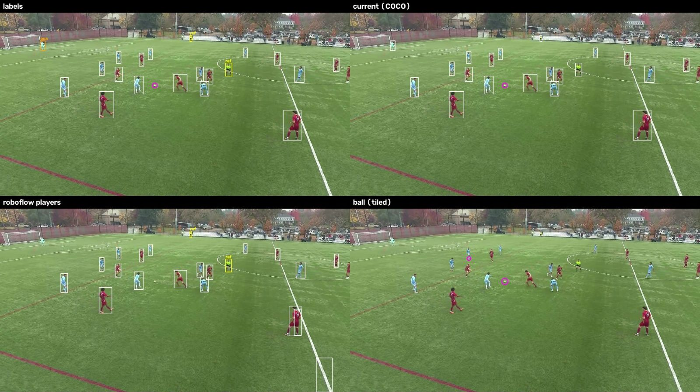
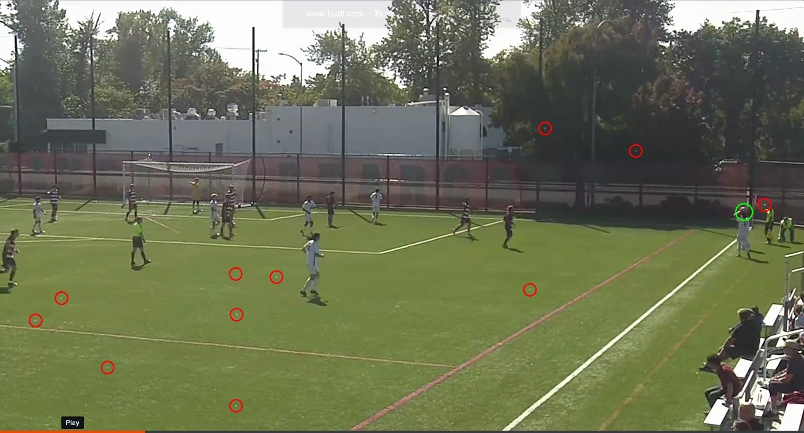

# Detection Model Experiments

The pipeline's first step is **detection**: finding every player, goalkeeper, referee and the ball in each frame. Everything after it (tracking, team assignment, ball path, events) can only work with what the detector finds. This page records a series of experiments, run in November 2026, that tested whether models trained specifically on soccer could replace the general-purpose detector the pipeline uses today.

**Short answer: they could not.** The general-purpose model beat every soccer-specific model on my own test-footage, often by a wide margin. The reasons are as useful for the project as a better model would have been.

## The problem

The pipeline uses **YOLOv8m trained on COCO**, which is a general dataset of everyday photos with 80 object types, including "person" and "sports ball". It knows nothing about soccer, nor was it ever intended to be used for soccer matches. However, it beats the models trained with soccer-specific datasets. The hypothesis (and the hope) was that training a model with these datasets would yield a more accurate detection. Clearly, it did not, and so, the pipeline continues to use **YOLOv8m trained on COCO**. Two weaknesses stood out on the test clips:

- **The ball is often missed.** The ball was found in only about 25–30 % of frames. It is small (10–30 px across in a 2880 px wide frame), often blurred, and often next to a player's foot.
- **It can't tell players, goalkeepers and referees apart.** COCO only knows "person". Roles are currently worked out afterwards from shirt colours.

Public models trained on soccer footage exist and come with labels for player, goalkeeper, referee and ball. The question was whether one of them would do better on **Willamette** footage.

## How it was tested

The experiments were deliberately kept out of the main pipeline. Every candidate lives in a separate file (`soccer-cv/experiments/soccer_models.py`) and is scored on the same frames. The rule was simple: **a new model only goes into the pipeline if it beats the current one on Willamette's own footage.**

### A test set from our own footage

120 frames were taken evenly from three Willamette clips. I hand-labelled 52 of them were with a small labelling tool built only for this specific experiment by an AI agent in a couple minutes (`experiments/label_tool.py`). The current model pre-labelled each frame, then every box was checked and corrected by hand.

| Clip | Frame size | Frames labelled | People | Balls |
| --- | --- | --- | --- | --- |
| `goal` | 2880 × 1553 | 15 | 253 | 11 |
| `test` | 1920 × 1079 | 21 | 340 | 14 |
| `wide` | 2880 × 1553 | 16 | 339 | 8 |
| **Total** | | **52** | **932** (802 players, 48 goalkeepers, 82 referees) | **33** |

Fans, coaches and substitutes off the pitch were marked as "ignore" regions, so no model is rewarded or punished for detecting them.

### What the numbers mean

| Metric | Meaning |
| --- | --- |
| **AP50** | Average precision: one score from 0 to 100 that covers both finding things and not raising false alarms, across every confidence level. Higher is better. |
| **Max recall** | The share of labelled objects found when every detection above the pipeline's low threshold (0.08) is kept. This is what the tracker gets to work with. |
| **Best F1** | The best balance of precision and recall at a single confidence cut-off. |
| **Match rule** | A person counts as found when the boxes overlap by at least 50%. A ball counts as found when the detected centre is within one ball diameter of the labelled centre, because a 10 px ball box that is 3 px off already fails a 50 % overlap test. |

## The candidates

For efficiency and faster processing time all soccer models were trained on Google Colab with a free T4 GPU, using the scripts in `experiments/train_on_colab.ipynb`.

| Candidate | Training data | Model and settings |
| --- | --- | --- |
| **Current (COCO)** | COCO (general photos) | YOLOv8m, 1920 px input, as used in the pipeline |
| **Roboflow players** | Roboflow *football-players-detection*: 298 training images from broadcast TV, labelled player / goalkeeper / referee / ball | YOLOv8m, 1280 px, 50 epochs |
| **Roboflow ball (tiled)** | Roboflow *football-ball-detection*: 3,956 broadcast images, cut into 1,324 tiles of 640 px around the ball plus empty tiles | YOLOv8s, 640 px tiles, 50 epochs. At test time the frame is cut into overlapping 640 px tiles at full resolution, so the ball isn't shrunk away. |
| **Ball mix (tiled)** | The Roboflow ball tiles plus **SoccerTrack** (wide-angle match footage, 6500 × 1000 panoramas at 25 fps). 5,286 SoccerTrack tiles: 1,746 with the ball, 3,540 without. Frames enlarged 2× so the ball matches the size in our footage. | YOLOv8s, 640 px tiles, 50 epochs, about 1.5 hours on Colab |

## Results

### Experiment 1: Roboflow players and ball models


*Figure 1: One test frame.*<br />
**Top left:** *hand labels (orange = goalkeeper, yellow = referee, pink circle = ball).*<br />
**Top right:** *the current COCO model finds every player, the goalkeeper and the ball.*<br />
**Bottom left:** *Roboflow players misses the goalkeeper, the ball, and draws a false box on the touchline.*<br />
**Bottom right:** *the tiled ball model finds the ball, plus one false alarm on a player's socks.*

**People** (932 labels)

| Candidate | AP50 | Max recall | Best F1 |
| --- | --- | --- | --- |
| **Current (COCO)** | **95.7** | **95.9** | **97.1** |
| Roboflow players | 69.7 | 71.7 | 76.7 |

**Roles** (Roboflow players model only, since COCO has no roles)

| Role | Labels | Recall | AP50 |
| --- | --- | --- | --- |
| Player | 802 | 73.7 % | 69.5 |
| Goalkeeper | 48 | **0 %** | 0.0 |
| Referee | 82 | 24.4 % | 22.2 |

The Roboflow model **did not find a single goalkeeper** in 48 chances. The keepers it did detect, it called players. Of the referees it detected, it called 39 "player" and only 14 "referee".

**Ball** (33 labels)

| Candidate | AP50 | Max recall | Best F1 |
| --- | --- | --- | --- |
| **Current (COCO)** | **50.4** | **54.5** | **62.5** |
| Roboflow players (ball class) | 18.2 | 18.2 | 30.8 |
| Roboflow ball (tiled) | 15.3 | 27.3 | 26.4 |

**Ball found, by size of the ball in the frame**

| Candidate | 10–20 px (14 balls) | 20+ px (18 balls) |
| --- | --- | --- |
| **Current (COCO)** | **78.6 %** | **38.9 %** |
| Roboflow players | 35.7 % | 5.6 % |
| Roboflow ball (tiled) | 42.9 % | 16.7 % |

(One labelled ball was under 10 px. No model found it.)

**Result:** the current model was better at everything. On people it scored 26 points higher, and on the ball about three times higher.

### Checking that the result was real

A gap that large called for checks that the test itself wasn't unfair:

| Check | Result |
| --- | --- |
| Were the labels biased toward the COCO model, which made the pre-labels? | No. Loosening the overlap rule to 30 % gave the same gap. |
| Did the Roboflow model just need bigger input pictures? | No. Larger input sizes made it **worse**. |
| Is a newer general model better? (YOLO11m, COCO) | No. People AP50 94.9, ball AP50 37.4, both below YOLOv8m. |
| Does tiling help the general model find the ball? (COCO YOLOv8m on 640 px tiles) | It found more balls (max recall 60.6 % vs 54.5 %) but raised more false alarms (AP50 31.6 vs 50.4). I deemed it not worth it. |

### Why the soccer models lost: the domain gap

The Roboflow datasets are **broadcast TV footage**: a high, central, professionally operated camera, professional kits, and a clean grass pitch. Our footage is different in almost every way:

- An **amateur sideline camera**, low and close, so near players are very large in the frame.
- **Screen recordings** of the HUDL player, with compression and browser bars.
- **Artificial turf** carrying other sports' lines.

A model trained on 298 broadcast images learns what soccer looks like **on TV**. The COCO model learned from hundreds of thousands of photos of people in every setting, so it handles our unusual camera better. This is called **domain gap**, and it is the main lesson of these experiments.

### Experiment 2: adding SoccerTrack data to the ball model

SoccerTrack is filmed with a fixed wide-angle camera, which is closer to our setup than broadcast TV. The idea was to combine it with the Roboflow ball data so the ball model would see both kinds of footage. The frames were enlarged 2× first, because the ball in SoccerTrack panoramas is about 8 px across while ours is 10–30 px.

| Candidate | AP50 | Balls found (of 33) | False alarms per frame |
| --- | --- | --- | --- |
| **Current (COCO)** | **50.4** | **18** (54.5 %) | very few (100 % precision at best cut-off) |
| Roboflow ball (tiled) | 15.3 | 9 (27.3 %) | 1.8 |
| Ball mix (tiled) | 5.1 | 15 (45.5 %) | **8.7** |

The extra data helped in one way: the mixed model found **67 % more real balls** than the Roboflow-only model (15 vs 9). But it raised almost **five times as many false alarms** (453 in 52 frames, against 93), which pushed its overall score down to 5.1.


*Figure 2: The ball mix model on a frame from a test clip. It finds the real ball (green, held for a throw-in by the corner flag) but also marks about 12 small white specks on the artificial turf, plus a few spots in the trees.*

Looking at the false alarms explained why. Most of them are **small white specks on the artificial turf** that stay in the same place from frame to frame. In SoccerTrack the ball is a tiny white dot on grass, so the model learned that "small white dot on green = ball". The pitch seems to reflect small white dots back to the camera, perhaps it's morning dew or water specks, or small trash, but nevertheless it caused mishap in the detection. This clip alone produced 116 false alarms above 30 % confidence in 15 frames, many of them at the same spots.

### Experiment 3: Core ML acceleration

Separately from accuracy, the current model was converted to Apple's **Core ML** format so it runs on the Mac's Neural Engine. It can be switched on with `--coreml`.

| Measure (12.5 s `wide.mp4` clip, M1 Mac) | Normal | Core ML | Change |
| --- | --- | --- | --- |
| Detection time | 48 s | 28 s | 42 % faster |
| Whole pipeline | 65 s | 45 s | 31 % faster |
| Detection accuracy | | | unchanged |

## Summary

| Question | Answer |
| --- | --- |
| Does a broadcast-trained soccer model find players better? | **No.** People AP50 69.7 vs 95.7; 0 of 48 goalkeepers found. |
| Does a dedicated ball model find the ball better? | **No.** Ball AP50 15.3 vs 50.4. |
| Does adding more soccer data (SoccerTrack) fix the ball model? | **Partly.** It finds 67 % more balls than before, but raises 8.7 false alarms per frame (AP50 5.1). |
| Is a newer general model (YOLO11m) better? | **No.** Slightly worse on both people and the ball. |
| Can detection be made faster without losing accuracy? | **Yes.** Core ML: 31 % faster end to end, same results. |
| **Decision** | **Keep the current COCO YOLOv8m in the pipeline.** Core ML is available as an option. |

## Lessons learned that shaped this project

1. **Measure on your own data.** A model trained specifically on soccer-data sounds like an easy and obvious upgrade, but none of them performed good on Willamette footage. Without these experiments and the 52 hand-labelled frames, I would have switched to a worse model unknowingly.
2. **More data is not automatically better data.** Adding SoccerTrack made the ball training set about five times larger and the overall score worse, because it taught the model a shortcut ("white dot = ball") that fails on our turf.
3. **Check what a model gets wrong, not just its score.** The false-alarm pictures showed a clear, fixable cause (specks that never move) that the AP number alone would have hidden.

## Next steps
- **Train on our own footage.** Label a separate set of frames from other Willamette clips (never the 52 test frames) and fine-tune on them, with soccer datasets as extra data. This includes empty turf tiles, so the model learns what our pitch looks like without a ball.
- **Keep the 52-frame test set fixed**, so every future model is compared on exactly the same frames.

## How to reproduce

From `soccer-cv/`:

```bash
# score the current model against trained candidates on the 52 labelled frames
python -m experiments.soccer_models eval --players experiments/data/weights/players.pt --ball experiments/data/weights/ball.pt
python -m experiments.soccer_models eval --ball experiments/data/weights/ball_mix.pt
python -m experiments.soccer_models eval --coco yolo11m.pt

# label or correct frames in the browser
python -m experiments.label_tool
```

Each run writes `report.md`, `metrics.json`, and side-by-side pictures to `experiments/data/eval/results/`. The runs quoted on this page are kept in `results_roboflow/`, `results_ball_mix/` and `results_yolo11m/`. Training is done in `experiments/train_on_colab.ipynb` on Google Colab. Datasets, weights and results are not in the repository because they are too large.
